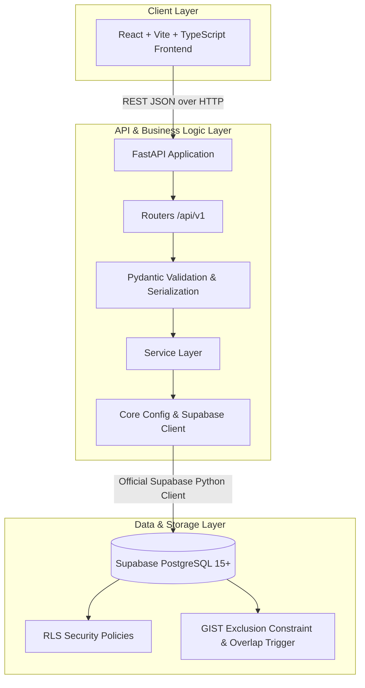
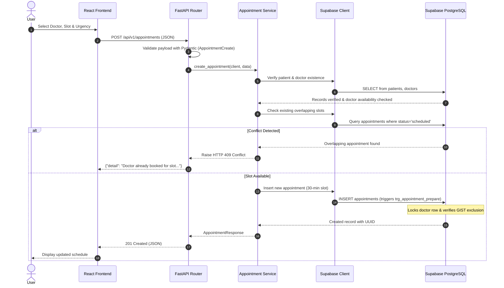

# System Architecture: Intelligent Medical Appointment Coordination

## 1. High-Level Architecture Overview

The system is designed as a modular 3-tier healthcare coordination system:



### Architectural Principles
1. **Separation of Concerns:** Route handlers only handle HTTP semantics, query parsing, and response status. Business logic lives strictly in `app/services/`.
2. **Modular Data Access:** Supabase client operations are decoupled through typed service functions, avoiding direct coupling to raw database queries in endpoint controllers.
3. **Defense-in-Depth Conflict Prevention:** Slot overlap protection is enforced at both the application service layer (for fast, descriptive error messages) and the PostgreSQL engine level (using GIST exclusion constraints and row-level serialization triggers) to guarantee race-free concurrency.
4. **Privileged Backend Security:** The backend communicates with Supabase using the service-role/secret key, bypassing RLS to perform administrative scheduling. The frontend communicates exclusively with FastAPI and is never exposed to Supabase secrets.

---

## 2. Request & Data Flow



---

## 3. Slot Conflict Prevention Strategy

For the MVP, appointments are modeled as fixed 30-minute intervals:
- `end_at = scheduled_at + 30 minutes`

To prevent concurrent race conditions (e.g., two users booking the same slot at the exact same millisecond):
1. **Application Pre-Check:** The service checks `appointments` table for any active overlapping appointment (`status = 'scheduled'`).
2. **Database Row Lock Trigger:** A PostgreSQL `BEFORE INSERT OR UPDATE` trigger locks the target doctor's record (`PERFORM id FROM doctors WHERE id = NEW.doctor_id FOR UPDATE`), serializing concurrent booking transactions for that doctor.
3. **GIST Exclusion Constraint:** An exclusion constraint (`no_overlapping_doctor_appointments`) backed by the PostgreSQL `btree_gist` extension declaratively guarantees that no two records for the same doctor with `status = 'scheduled'` can overlap in time:
   ```sql
   ALTER TABLE appointments
   ADD CONSTRAINT no_overlapping_doctor_appointments
   EXCLUDE USING gist (
       doctor_id WITH =,
       tstzrange(scheduled_at, end_at, '[)') WITH &&
   )
   WHERE (status = 'scheduled');
   ```

---

## 4. Error Handling and Status Codes

| Status Code | Condition | Example Response |
|---|---|---|
| `200 OK` | Successful retrieval or cancellation | `{"status": "cancelled", ...}` |
| `201 Created` | Successful creation of patient, doctor, or appointment | Created entity object with UUID |
| `400 Bad Request` | Business rule violation (e.g., doctor is marked unavailable) | `{"detail": "Doctor is currently unavailable for bookings."}` |
| `404 Not Found` | Referenced doctor or patient ID does not exist | `{"detail": "Patient with ID '...' not found."}` |
| `409 Conflict` | Slot double-booking / overlap detected | `{"detail": "Scheduling conflict: Doctor already has an overlapping slot."}` |
| `422 Unprocessable Content` | Request payload schema validation failure | Validation details list |
| `503 Service Unavailable` | Supabase credentials missing or database unreachable | `{"error": "Database Service Unavailable", ...}` |

---

## 5. Security & Row Level Security (RLS)

- **Backend Privileged Key:** The backend uses `SUPABASE_SECRET_KEY` (or `service_role` key). In Supabase, this key bypasses Row Level Security so the coordination service can query and update patient triage schedules.
- **Frontend Isolation:** The frontend only knows `VITE_API_BASE_URL` (pointing to FastAPI). No Supabase database credentials or secrets are accessible or exposed in client bundles.
- **Database RLS Policies:** RLS is enabled on all tables (`patients`, `doctors`, `appointments`). In the event that anonymous clients interact with Supabase directly, read access is limited to doctors, and modification is blocked.
