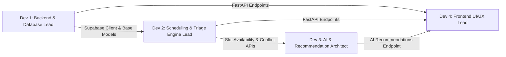

# Team Work Breakdown & Parallel Execution Guide

**Project:** Intelligent Medical Appointment Coordination  
**Duration:** 3-Hour Rapid Delivery Buildathon  
**Team Size:** 4 Developers  
**Primary Database:** Supabase PostgreSQL

---

## 1. Role Distribution & Responsibilities



---

### Developer 1: Backend & Database Lead
*Focus:* Supabase PostgreSQL integration, environment configurations, base CRUD APIs, and RLS policies.
- **Responsibilities:**
  - Verify and apply `supabase/schema.sql` in Supabase project.
  - Maintain `app/core/config.py` and `app/db/supabase_client.py`.
  - Extend patients and doctors CRUD APIs (`routes/patients.py`, `routes/doctors.py`).
  - Add search/filtering by doctor specialization or patient contact.
  - Implement doctor working hours or shift schedules in the database.
- **Deliverables & Files:**
  - `backend/app/db/`
  - `backend/app/api/routes/patients.py`
  - `backend/app/api/routes/doctors.py`
  - `supabase/schema.sql`

---

### Developer 2: Scheduling & Triage Engine Lead
*Focus:* Slot computation, conflict prevention, cancellation workflows, priority queueing.
- **Responsibilities:**
  - Compute available 30-minute doctor slots for a given calendar day:
    - Input: `doctor_id`, `date: YYYY-MM-DD`
    - Output: Array of available `[HH:MM - HH:MM]` slots excluding booked/cancelled slots.
  - Handle urgent patient slot preemption / priority bumping logic (e.g., reassigning normal checkups when an urgent request arrives).
  - Enhance `appointment_service.py` with multi-doctor load balancing.
- **Deliverables & Files:**
  - `backend/app/services/appointment_service.py`
  - `backend/app/api/routes/appointments.py` (e.g., `GET /appointments/available-slots`)
  - `backend/app/tests/test_appointments.py`

---

### Developer 3: AI & Recommendation Architect
*Focus:* Natural language consultation request interpretation, urgency prioritization, and smart doctor matching.
- **Responsibilities:**
  - Build `backend/app/services/ai_triage_service.py`.
  - Accept unformatted patient notes (e.g. "I'm experiencing sudden chest tightness radiating to left arm").
  - Extract:
    - Likely symptoms & urgency level (`urgent`, `high`, `normal`).
    - Recommended specialization (`Cardiology`, `Neurology`, `General`).
  - Call Developer 2's `available-slots` engine to suggest the top 3 optimal appointments.
  - Expose `POST /api/v1/ai/triage` and `POST /api/v1/ai/recommend-slots`.
- **Deliverables & Files:**
  - `backend/app/services/ai_triage_service.py`
  - `backend/app/api/routes/ai_coordination.py`
  - Unit tests with mock LLM outputs.

---

### Developer 4: Frontend UI/UX Lead
*Focus:* React/TypeScript user experience, triage workflow, calendar view, real-time indicators.
- **Responsibilities:**
  - Enhance `frontend/src/pages/Dashboard.tsx` and summary metrics.
  - Implement interactive doctor slot picker based on Developer 2's available slots API.
  - Implement AI Triage assistant widget (input free-text symptoms -> render AI recommended slots).
  - Add notification banners for booking confirmations and cancellation alerts.
- **Deliverables & Files:**
  - `frontend/src/components/`
  - `frontend/src/pages/`
  - `frontend/src/api/client.ts`

---

## 2. Shared Interfaces & Integration Contract

To prevent git merge conflicts and blocking dependencies, team members agree to these contracts:

### A. Slot Availability Interface (Dev 2 -> Dev 3 & Dev 4)
```python
# Endpoint: GET /api/v1/appointments/available-slots?doctor_id=...&date=2026-10-20
class DoctorAvailableSlot(BaseModel):
    doctor_id: UUID
    start_time: datetime
    end_time: datetime
    is_available: bool
```

### B. AI Triage Output Interface (Dev 3 -> Dev 4)
```python
# Endpoint: POST /api/v1/ai/triage
class TriageRequest(BaseModel):
    patient_id: UUID
    symptoms_text: str

class TriageRecommendation(BaseModel):
    recommended_specialization: str
    suggested_priority: Literal["normal", "high", "urgent"]
    urgency_rationale: str
    suggested_doctors: List[DoctorResponse]
    recommended_slots: List[datetime]
```

### C. Git Workflow Rules
1. Never edit another teammate's service file without coordinating.
2. Put new routes in their own dedicated files inside `app/api/routes/` and register them in `app/api/routes/__init__.py`.
3. Run `pytest backend/app/tests` and `npm run build` locally before opening pull requests.
